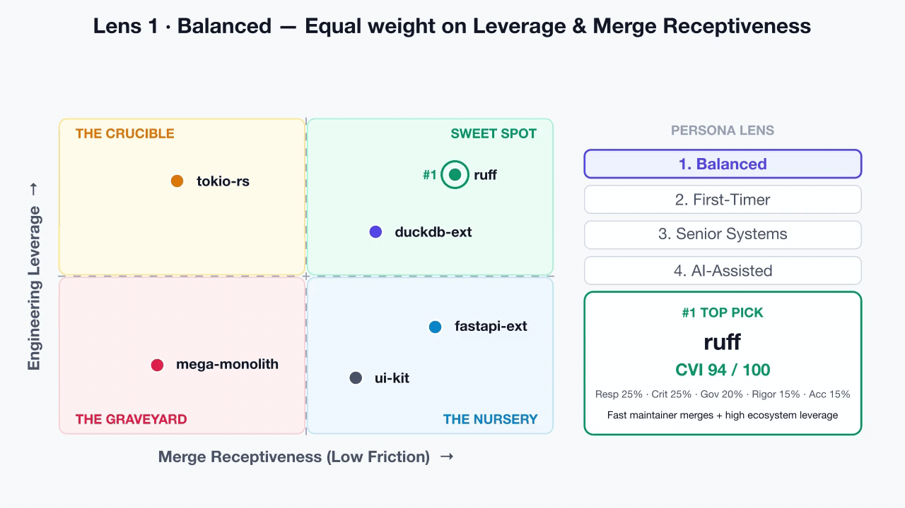

# Porchlamp

**Find the projects that leave the light on.**

A porch lamp left on tells a visitor they are expected. Porchlamp ranks
open-source projects the same way: by what happens to a stranger's pull
request, not by how many stars the project has.

**Open the ranking: https://pctablet505.github.io/porchlamp/**

## Stars don't review pull requests

Measured on the 2026-10-13c snapshot of 11,000 projects:

- **More than a third of active projects are black holes.** Of the 4,358
  licensed, maintained software projects that received at least ten outside pull
  requests in six months, 1,610 (36.9%) left most of them with no human reply,
  review or merge for two weeks. Counting only pull requests opened by people,
  not bots, gives 56.3%.
- **More stars, more silence.** The black-hole share rises with popularity: 33%
  of projects with 1k–10k stars, 40% at 10k–50k, and 48% at 50k or more.
- **Stars barely predict the ranking.** Across the 3,407 ranked projects the
  rank correlation between stars and the Porchlamp score is 0.13, and 9 of the
  100 most-starred projects make the top 100.

## Where the numbers come from

We followed 212,390 pull requests from 110,605 outside contributors to 11,000
projects over six months: who got an answer, how fast, how many reached a
decision, whether first-time contributors came back, and how much other software
depends on each project. Black holes, and projects that are archived,
unmaintained, unlicensed or not software, are listed but never ranked. The rest
are scored on five pillars and re-weighted for five kinds of contributor. Every
number traces back to a recorded GitHub response and its content hash.

## This repository

This repository is the published site and nothing else: a static snapshot
served by GitHub Pages. Every ranking, filter and project page is answered
from precomputed JSON under `data/2026-10-13c/` by `api.js` (project records sharded into 256
hash-bucketed files under `data/2026-10-13c/repos/`), so the site needs no
server.

- **Snapshot ID:** `2026-10-13c` (measured as of `2026-10-13T04:32:26+00:00`, benchmark `2.0.0-rc1`)
- **Universe Counts:** `3,407` rated (ranked) · `6,267` gated (Stage 0) · `1,326` unrated (`<60%` coverage) · `11,000` total
- **Persona Visible Counts:** `balanced: 3,407` · `first_timer: 1,728` · `career_capital: 739` · `senior_systems: 1,108` · `ai_assisted: 3,502`
- **Verification Hashes:** `constants_hash: aca719a92226…` · `manifest_root: 64813656fcfd…` · `canonical_dump_hash: 8a3e5a00be45…`

